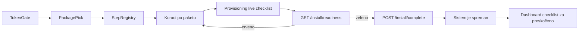

# Install Wizard v2 — pregled

> Status: **plan, čeka potvrdu vlasnika** · Datum: 2026-10-15 · Izvor: review modula 11 (`audit/frontend/11-install.md`) i review sesija 2026-10-15.
> Ovaj folder je jedini izvor istine za v2. Postojeći `.cursor/docs/04-install-wizard.md` i `.cursor/docs/matrices/install-wizard/MATRIX.md` se usklađuju u F0, a proširuju kroz F1–F6.

## 1. Cilj

Install wizard je prvi kontakt klijenta sa sistemom. v2 mora:

1. Završiti sistemom koji **odmah prima i obrađuje tikete** (paket Minimum je garancija).
2. Ponuditi **profesionalna, potpuna podešavanja** kroz tri paketa, uz „Podesi kasnije“ gdje je moguće.
3. **Prezentovati funkcionalnost** koju sistem nosi (šta klijent dobija), ne samo prikupljati polja.
4. Izgledati **unikatno i profesionalno**, uz animacije s funkcijom i ikone, pod eksplicitnim izuzetkom od Constitution-a (vidi §6).

## 2. Fiksne odluke vlasnika

| # | Odluka |
|---|---|
| D1 | Tri fiksna paketa: **Minimum / Standard / Full**. Svaki uključuje prethodni. Unutar paketa moguće je ručno dotjerivanje (uključiti/isključiti pojedinu stavku). |
| D2 | Izuzetak od `docs/design/Master UI-UX Design Constitution.md` važi **samo za install wizard**: brend pano, animacije s funkcijom, ikone funkcija, završni ekran. Obavezno `prefers-reduced-motion`. |
| D3 | Minimum garantuje da sistem odmah prima tikete. **Bez demo tiketa** (zabrana iz MATRIX-a ostaje). |
| D4 | „Podesi kasnije“ gdje je moguće. Svaka preskočena stavka ulazi u post-instalacijsku checklistu na dashboardu. |
| D5 | Install wizard i service onboarding wizard (`backend/src/modules/service-onboarding/`) ostaju odvojeni sistemi. Install smije **koristiti** iste domenske funkcije, ali ne dijeli stanje ni UI. |

## 3. Definicija „spremno za tikete“ (readiness)

Instalacija se smije završiti tek kad su sve stavke zelene. Provjeru radi **novi** `GET /install/readiness`, a `POST /install/complete` je ponavlja i odbija završetak ako nešto nije zeleno.

| Ključ provjere | Uslov | Danas |
|---|---|---|
| `superAdmin` | postoji lokalni super admin | provjerava se |
| `authMode` | `private.auth.mode` sačuvan i validan | samo kroz `nextStep` |
| `organizationalUnit` | postoji barem jedna OU | seed |
| `handlerGroup` | postoji fallback grupa s **barem jednim aktivnim članom** | grupa bez članova |
| `service` | barem jedan ACTIVE servis s ACTIVE verzijom forme | seed |
| `routing` | `resolveTicketRouting` za (OU, servis) daje `EXACT` | seed (`assertSeedResolution`) |
| `slaProfile` | servis ima SLA profil ili postoji default profil | seed pri startu (`starting-sla-seed.service.ts`) |
| `roles` | sistemske uloge i default permisije postoje | `seedDefaultRolePermissions` nakon seeda |
| `jwtSecret` | biće provisioniran u `complete` (ne blokira) | `ensureInstallJwtSigningSecret` |
| `profileSteps` | svi obavezni koraci izabranog paketa su `completed` ili dozvoljeno `skipped` | ne postoji |

Readiness ne kreira tiket. Routing se provjerava „dry-run“ pozivom `resolveTicketRouting`.

## 4. Paketi

Legenda: **O** = obavezno u paketu · **K** = ponuđeno, može „kasnije“ · **—** = nije dio paketa (dostupno kasnije u Settings).

| Stavka / korak | Minimum | Standard | Full | Postojeći izvor |
|---|---|---|---|---|
| Install token gate | O | O | O | `install-token-gate.tsx`, `install-token.ts` |
| Izbor paketa | O | O | O | **novo** |
| Super admin (break-glass) | O | O | O | `install-super-admin.service.ts` |
| Identitet: naziv organizacije, jezik, vremenska zona | O | O | O | `public.branding.organizationName`, `private.i18n.defaultLocale`, `private.reports.timeZone` |
| Identitet: logo, naziv aplikacije, support email/URL | K | K | K | `public.branding.*` |
| Način prijave (local / Entra/AD) | O | O | O | `install-login-provider.service.ts` |
| Struktura: imenovana OU i grupa | O | O | O | seed (parametrizovati) |
| Tim: poziv agenata u grupu | K | O | O | `UsersService.create`, članstvo grupe |
| Prvi servis s formom + routing + SLA | O | O | O | seed (parametrizovati) |
| SMTP + test-slanje | K | O | O | `install-smtp.service.ts`, `email-templates` test |
| Email notifikacije (dodatak `email`) | — | O (ako SMTP) | O | `addon-catalog.ts` |
| Katalog servisa iz predloška (blueprint) | — | O | O | **novo** (po uzoru na `policy-pack.registry.ts`) |
| Grupe L1/L2 | — | K | K | blueprint |
| Policy pack `IT Standard` na OU | — | O | O | `policy-packs/apply-policy-pack.ts` |
| SLA pregled: profili, kalendar, priority matrica | — | K | K | `sla/seed-starting-sla-profiles.ts`, `seed-priority-matrix.ts` |
| Dodaci sa prezentacijom (CSAT, approvals, confidential, kbIntercept, ticketSplit, bulkActions, savedViews, reports) | core default | O (pregled) | O (pregled) | `addon-catalog.ts` |
| Inbound email (mailbox postaje tiket) | — | — | K | `inbound-email-settings.ts` |
| Directory sync / LDAPS, mapiranje uloga | — | — | K | `directory-sync-settings.ts`, `directory-ldaps-settings.ts` |
| Baza znanja (kategorije) | — | — | K | `knowledge-base-settings.ts` |
| Status stranica | — | — | K | `private.statusPage.*` (`ops-settings.ts`) |
| On-call raspored | — | — | K | `on-call-settings.ts` |
| Obavještenja | — | — | K | `announcement-settings.ts` |
| ITSM moduli: CMDB, problemi, promjene | — | — | K | dodaci `cmdb`, `problems`, `changes` |
| Integracije: Teams, Edge ekstenzija | — | — | K | dodaci `teams`, `edge` |
| Sigurnost: MFA, captcha, sesija, HIBP, rate limit | — | K (preporuke) | K | `account-security-settings.ts`, `security-*-settings.ts` |
| Privacy notice, retencija podataka, audit webhook | — | — | K | `privacy-settings.ts`, `data-lifecycle-settings.ts`, `security-audit-webhook-settings.ts` |
| Provisioning + readiness | O | O | O | **novo** |
| Završni ekran „Sistem je spreman“ | O | O | O | **novo** |

Procjena vremena za korisnika: Minimum oko 5 min, Standard oko 15 min, Full oko 30 min (većina Full stavki ima „kasnije“).

## 5. Ciljna arhitektura

**Backend**
- **Registry koraka (novo, F1):** svaki korak ima `key`, `requiredIn` (paketi), `skippable`, `readStatus()`, `save()`. `nextStep` se računa iz registryja i izabranog paketa umjesto fiksne funkcije `resolveNextInstallStep` u `install-setup.service.ts`.
- **Novi settings (F1):** `private.install.profile` (`minimum` | `standard` | `full`), `private.install.steps.<key>.skipped` (boolean). Oba su environment-bound (prefiks `private.install.` je već u `environmentBoundSettingPrefixes`).
- **Readiness (F0 osnova, F1 endpoint):** čista funkcija `evaluateInstallReadiness` koju koriste `GET /install/readiness` i `complete`.
- **Install blueprints (novo, F4):** deklarativne definicije (katalog servisa, grupe, forme) nad postojećim `ensure-install-*` funkcijama i `apply-policy-pack.ts`. Idempotentno, kao današnji seed.
- **Install-scoped wrapperi (F2, F4):** tim (kreiranje korisnika i članstvo) i SMTP test pozivaju domenske servise; ne otvaraju sesijske endpointe prije završetka instalacije.

**Frontend**
- Jedan izvor statusa (`InstallSetupProvider`) koji nosi i `nextStep`, `profile` i readiness.
- Zajednički hook za korake: `loading | error | ready`; forma se ne prikazuje dok stanje nije poznato.
- Nova ljuska (F3) s podijeljenim ekranom; svaki korak u svom fajlu, maksimalno 200 linija.

## 6. UX i vizuelni pravac (izuzetak D2)

- **Podijeljen ekran:** lijevo brend pano (`.pulse-gradient`, već dozvoljen izuzetak u `.cursor/rules/frontend-ui-ux.mdc`) s trakom koraka i ikonama, te živim panelom „Šta dobijaš“; desno sadržaj koraka. Na mobilnom pano postaje kompaktno zaglavlje.
- **Izbor paketa:** tri kartice za poređenje (ikone funkcija, procjena vremena, lista stavki, „Preporučeno“ na Standard).
- **Kartice funkcija:** ikona (lucide), jedna rečenica vrijednosti, oznake zavisnosti (npr. „treba SMTP“), prekidač.
- **Motion s funkcijom:** prelaz između koraka (oko 200 ms, fade + mali pomak), napredak trake, provisioning ekran sa stavkama koje se „otkucavaju“ dok backend radi, završni ekran sa sažetkom. Bez floating blobs, bounce i dekorativne pozadinske animacije ni u izuzetku.
- **Reduced motion:** svi prelazi imaju statičnu varijantu.
- **Pristupačnost:** greške `role="alert"`, napredak `aria-live="polite"`, fokus na naslov koraka pri prelazu.

## 7. Faze

| Faza | Fajl | Sažetak | Zavisi od |
|---|---|---|---|
| F0 | `01_phase-f0-stabilizacija.md` | bugovi, readiness guard, docs sync, zapis izuzetka | — |
| F1 | `02_phase-f1-backend-osnova.md` | registry, profil, skip, readiness endpoint | F0 |
| F2 | `03_phase-f2-minimum-sadrzaj.md` | identitet, parametrizovan seed, tim | F1 |
| F3 | `04_phase-f3-nova-ljuska.md` | nova ljuska, izbor paketa, motion | F1 (F2 paralelno) |
| F4 | `05_phase-f4-standard-sadrzaj.md` | SMTP test, blueprints, SLA, policy pack, dodaci | F2, F3 |
| F5 | `06_phase-f5-full-sadrzaj.md` | Full stavke (većinom „kasnije“) | F4 |
| F6 | `07_phase-f6-zavrsetak-testovi.md` | završni ekran, checklist widget, testovi | F2–F5 |

## 8. Rizici

| Rizik | Uticaj | Ublažavanje |
|---|---|---|
| Registry koraka mijenja ugovor `GET /install/status` | postojeći E2E i `ensure-install.ts` | zadržati postojeća polja; `profile` default `minimum` kad nije postavljen |
| Install-scoped kreiranje korisnika prije sesije | sigurnost | samo uz install token, samo dok instalacija nije završena, isti validatori kao `UsersService.create` |
| Parametrizovan seed i postojeće instalacije | duplikati | idempotentni `ensure-*` sa lookup po ključu/slugu; postojeći podaci se ne preimenuju bez potvrde |
| Animacije i performanse na slabim mašinama | utisak kvaliteta | CSS transform/opacity, bez teških biblioteka; reduced-motion |
| Full paket postaje predug | odustajanje | većina stavki „kasnije“, checklist na dashboardu |
| Docs drift (04 i MATRIX) | pogrešne odluke | F0 ih usklađuje; svaka faza ažurira MATRIX i CHANGELOG matrice |

## 9. Odluke vlasnika (potvrđeno 2026-10-15)

Ova sekcija zamjenjuje ranija „otvorena pitanja“; odgovori su obavezujući za F0–F6.

1. **Auto-prijava nakon `complete`:** ne. Završetak vodi SuperAdmina na `/login` (bez automatske sesije). Jednostavnije je i sigurnije, a break-glass prijava ionako postoji.
2. **Poziv tima bez SMTP-a:** pokazati privremenu lozinku **jednom** na ekranu, koristeći postojeći ugovor `temporaryPassword` / `temporaryPasswordDelivery` iz toka kreiranja korisnika (`create-user.ts`, `issue-temporary-password-for-user.ts`). Bez novog mehanizma za dostavu. (Korak Tim je F2 — u F0/F1 se samo dokumentuje.)
3. **Blueprinti:** prva verzija IT + HR + Finance, uz postojeće policy packove `itStandard`, `hrRestricted`, `financeRestricted`. (Primjena blueprinta je F4; F1 priprema registry/profil da ih podrži.)
4. **Full i ITSM moduli:** CMDB, problemi i promjene su u paketu Full **uključeni po defaultu** (`install-profile.catalog.ts` nosi `defaultEnabledAddons: ['cmdb','problems','changes']`). Stvarno uključivanje i prezentacija su F4/F5 — F1 samo pamti koje korake/dodatke paket nudi.
5. **Promjena paketa tokom wizarda:** dozvoljena dok je operater na koraku paketa. Pri promjeni paketa briše/resetuje se stanje koraka koje novi paket **ne sadrži**, i to po eksplicitnom registry planu (`plan-install-profile-reset.ts` → `resettableSettingKeys`): u F1 su to flagovi dodataka i „Podesi kasnije“ oznake; kredencijali, identitet i seed podaci se nikad ne brišu. Koraci koje sadrže oba paketa zadržavaju stanje. Nakon prvog seeda dozvoljena je samo **nadogradnja** (`INSTALL_PROFILE_LOCKED_AFTER_SEED`).
6. **`INSTALL_ALLOW_RERUN`:** ostaje ops-only; za redovne administratore nema promjene semantike. „Dodaj paket kasnije“ iz Settings je F5 tema, ne F1.
7. **Sigurnosne preporuke** (preporuka agenta za F5, dokumentovane vrijednosti): MFA obavezan za administratore (`private.auth.mfa.requiredForAdmins = true`), MFA opcion za ostale (`private.auth.mfa.allowOptional = true`), HIBP uključen (`private.security.hibp.enabled = true`), idle sesija **1800 s** (30 min) ako je validator podržava, captcha **isključena u wizardu** dok se Turnstile ključevi ne unesu (ne forsirati captcha bez ključeva). UI preporuka je F5.
8. **Inbound i LDAPS test:** postojanje dolazne pošte i LDAPS-a tvrdi sam operater; **nema automatskog testa** u wizardu i nema `/install/inbound` ni `/install/ldaps` test ruta u F1. Test na zahtjev (dugme „Testiraj sada“) je F5.

### Stanje izvršenja

- **F0:** završeno (F0.1–F0.8), vidi `CHECKLIST.md` i `CHANGELOG.md`.
- **F1:** završeno (registry koraka, paket, odgađanje, readiness endpoint, kompatibilnost `status`-a).
- **F2 je sljedeća faza.**
